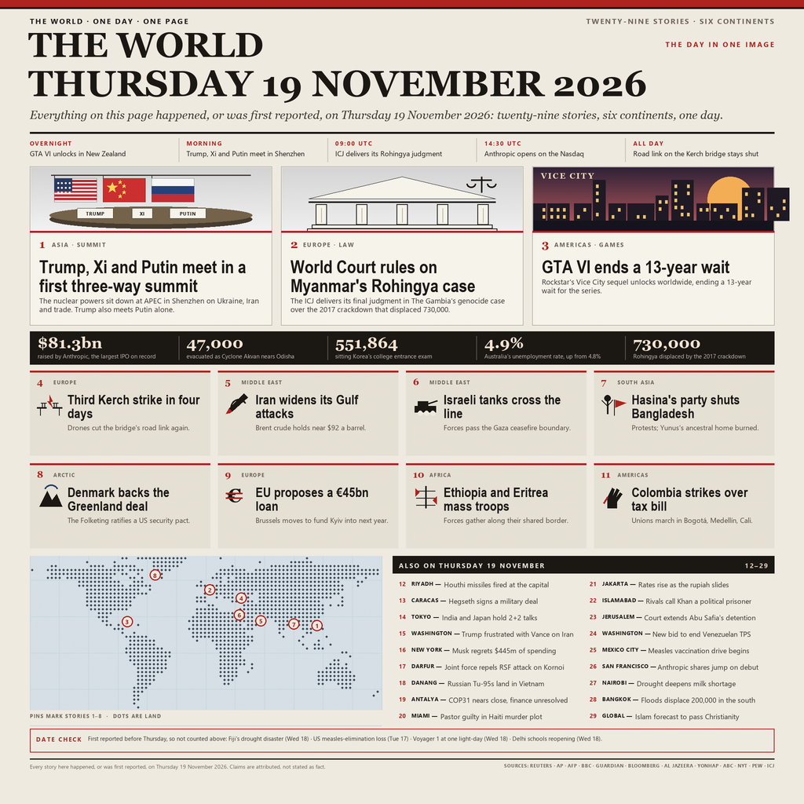

# The World — 19 November 2026, in one image

One front page that sums up the day's world news.



**Lead:** Trump, Xi and Putin meet in Shenzhen — the first three-way US–China–Russia
summit, with Ukraine, Iran and trade on the table.

**Two more leads:** the ICJ delivers its judgment in The Gambia's genocide case
against Myanmar over the 2017 crackdown that displaced 730,000 Rohingya; GTA VI
unlocks worldwide, ending a 13-year wait.

**The day, in brief:** Ukraine keeps the Kerch bridge's road link shut with drone
strikes; Iran widens its Gulf attacks as Brent holds near $92; Israeli forces cross
the Gaza ceasefire line; Hasina's party shuts down Bangladesh; Denmark ratifies its
Greenland security deal with Washington; the EU proposes a €45bn loan to Kyiv;
Ethiopia and Eritrea mass troops on their border; Colombia strikes over the tax bill.

**Also, in one line each:** a Houthi missile fired at Riyadh, Hegseth in Caracas,
India–Japan 2+2 talks, Musk's regret over $445m of midterm spending, an RSF attack
repelled at Kornoi, Russian Tu-95s in Vietnam, COP31's close, a conviction in the
Haiti murder plot, Bank Indonesia's rate rise, Imran Khan, Abu Safia's detention,
Venezuelan TPS, Mexico's measles drive, Anthropic's first trade, Kenya's milk
shortage, Bangkok's floods, and the forecast that Islam will pass Christianity.

## How it is made

`tools/make_image.py` composes the page with Pillow from the day's headlines: three
illustrated leads, a band of figures, eight briefs, a dotted world map with eight
numbered datelines, eighteen one-line reports, and a date-check strip naming what
was reported earlier and so is left out. The map is drawn from Natural Earth's
1:110m land polygons (public domain); the dots are point-in-polygon samples under an
equirectangular projection. The random seed is fixed, so two renders are
byte-identical. It is rendered at 2× and downsampled to 1024×1024.

`main.ts` publishes the committed artwork:

```sh
MAKEFUN_OUTPUT_DIR=./out node main.ts   # writes ./out/entry.png
```

It checks the 1 MiB and 1024×1024 caps, writes the bytes, and reads them back to
confirm the copy. No network, no clock, no randomness: the two graded runs write
the same bytes.

## Sources

Reporting from Reuters, AP, AFP, BBC, The Guardian, Bloomberg, Al Jazeera, Yonhap,
ABC, The New York Times, Pew Research and the ICJ on 19 November 2026.
Map data: [Natural Earth](https://www.naturalearthdata.com/), 1:110m land (public domain).

## Licence

MIT — see [LICENSE](LICENSE).
